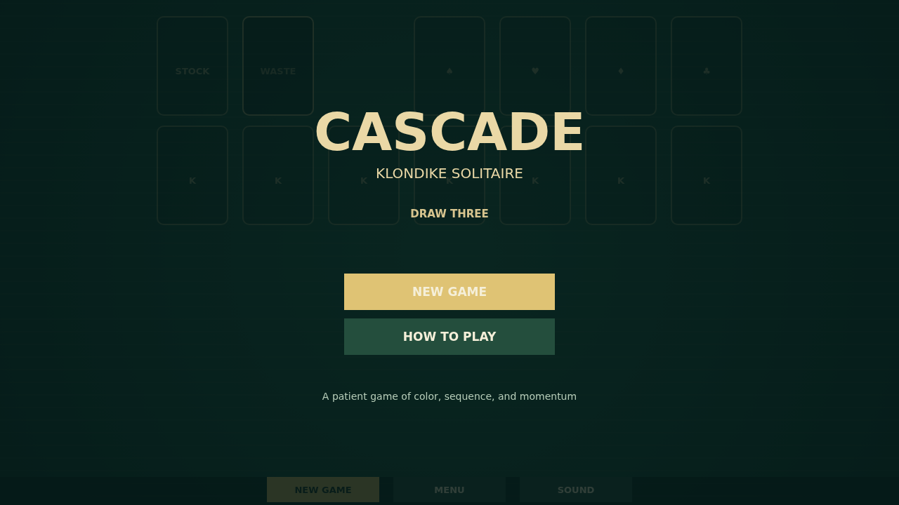

Cascade is Klondike solitaire on a quiet felt table. Build four foundations from Ace to King, one suit at a time, while uncovering the cards beneath the tableau.

Move a face-up card or a correctly ordered run by dragging it to another column. Columns descend in rank and alternate red and black; only a King can start an empty column. Send a playable card home with a double-click.

Turn three cards from the stock at a time. Work from the newest fan on the waste, then recycle the waste when the stock runs out. The game leaves room to think between moves.

When the last card reaches its foundation, the table gives way to the Cascade: cards lift, arc, bounce, and paint the felt until the whole table is covered.

